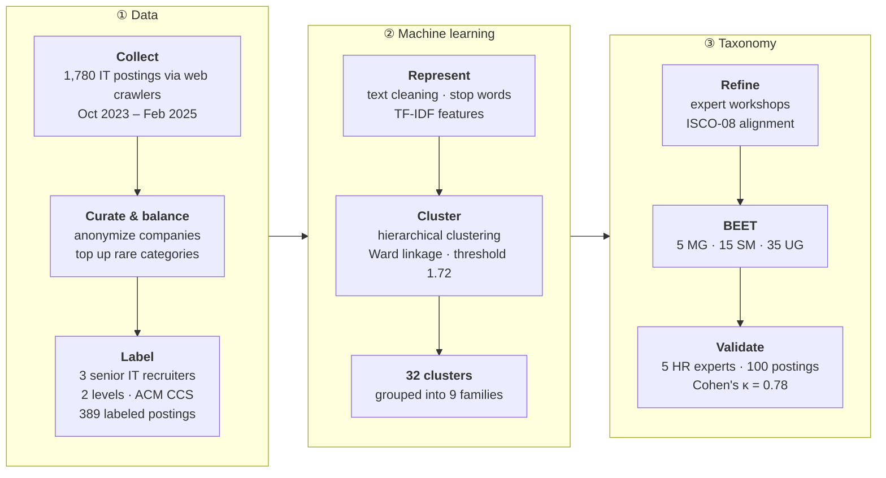

<div align="center">

<sub>RESEARCH PAPER · FRONTIERS IN EDUCATION · 2025</sub>

<h1>BEET: Skill-based IT Jobs Taxonomy</h1>

<p><b>B</b>ee-inspired <b>E</b>mployment and <b>E</b>xpertise <b>T</b>axonomy: a hierarchical, ISCO-08–aligned framework for classifying IT jobs in the Industry 5.0 era</p>

<sub>Jorge Valverde-Rebaza · Fabiana Rodrigues de Góes · Julieta Noguez · Nathalia C. Da Silva</sub><br>
<sub><i>Tecnológico de Monterrey (Mexico) · Visibilia (Brazil)</i></sub>

<a href="https://www.frontiersin.org/journals/education/articles/10.3389/feduc.2025.1418184/full"></a>
<a href="https://doi.org/10.3389/feduc.2025.1418184"></a>
<a href="data/BEET-v2025-rev2.xlsx"></a>


<br>

<table>
  <tr>
    <th colspan="3"><br>From Job Postings to Taxonomy<br><br></th>
  </tr>
  <tr>
    <td align="center" width="280"><br><sub>STEP 1</sub><br><b>Collect</b><br><sub>1,780 global IT job postings</sub><br><br></td>
    <td align="center" width="280"><br><sub>STEP 2</sub><br><b>Label</b><br><sub>HR experts + ACM CCS</sub><br><br></td>
    <td align="center" width="280"><br><sub>STEP 3</sub><br><b>Cluster</b><br><sub>TF-IDF + hierarchical clustering</sub><br><br></td>
  </tr>
  <tr>
    <td colspan="3" align="center">↓<br><br><b>BEET v2025-rev2</b><br><sub>5 Major Groups · 15 Sub-major Groups · 35 Unit Groups</sub><br><br></td>
  </tr>
</table>

<table>
  <tr>
    <td align="center" width="210"><h3>389</h3><sub>Labeled job postings</sub></td>
    <td align="center" width="210"><h3>221</h3><sub>Companies</sub></td>
    <td align="center" width="210"><h3>23</h3><sub>Countries</sub></td>
    <td align="center" width="210"><h3>κ = 0.78</h3><sub>Expert agreement</sub></td>
  </tr>
</table>

<sub>
<a href="#-at-a-glance">At a glance</a> ·
<a href="#-the-taxonomy">Taxonomy</a> ·
<a href="#-how-beet-was-built">Method</a> ·
<a href="#-inside-the-dataset">Dataset</a> ·
<a href="#-what-each-major-group-talks-about">Word clouds</a> ·
<a href="#-who-is-beet-for">Applications</a> ·
<a href="#-research-artifacts">Artifacts</a> ·
<a href="#-citation">Citation</a>
</sub>

</div>

<br>

## ◆ At a glance

IT roles increasingly dominate the global job market, yet the systems used to classify jobs were not designed for them. The ILO's **ISCO-08**, and its national adaptations such as Mexico's SINCO, Canada's NOC or Australia and New Zealand's ANZSCO, give a global baseline but **lack the granularity** to tell a Site Reliability Engineer from a DevOps Engineer, or an AI Architect from a Data Engineer.

**BEET** fills that gap. It is a hierarchical taxonomy that classifies IT jobs **within the ISCO-08 structure**. Following ISCO guidelines, it prioritizes the **hard skills** a job requires, regardless of how they were acquired. It was built bottom-up from real job postings, combining NLP, hierarchical clustering and the judgement of experienced IT recruiters.

> [!IMPORTANT]
> **TL;DR.** From 1,780 IT job postings collected worldwide (Oct 2023 – Feb 2025), the authors derived **5 major groups → 15 sub-major groups → 35 unit groups**. Independent HR experts classifying postings with BEET reached **substantial agreement (Cohen's κ = 0.78)**. BEET is already in use inside **BeeNet**, a recommender system that helps HR teams match IT candidates to openings.

<br>

## ◆ The taxonomy

<p align="center">
  <a href="figs/BEET.png"></a><br>
  <sub><b>Fig. 2</b> · The full BEET hierarchy: major groups (MG) → sub-major groups (SM) → unit groups (UG). Click to enlarge.</sub>
</p>

| Major group | Focus | Sub-major groups | Unit groups | Postings |
| :---------- | :---- | :--------------- | :---------: | -------: |
|  **System** | Design of reliable, safe and sustainable systems, from circuits to quantum | Micro & Small Systems · Macro Systems | 7 | 98 |
|  **Infrastructure** | Foundational technologies: architecture and networks, physical and cloud | Architecture · Networking | 4 | 50 |
|  **Development** | Design, build, operation and validation of software | Software Architecture · Software Development · Operations · eXperience · Validation & Verification | 13 | 115 |
|  **Data** | Collection, analysis and engineering of data and AI | Data Collection & Management · Data Analysis & Insights · AI Strategies & Engineering | 6 | 95 |
|  **Management** | Aligning IT, systems, data and AI with organizational goals | IT Management · Systems Management · Data & AI Management | 5 | 31 |

<sub><i>Postings</i> = number of labeled job postings in the BEET dataset assigned to each major group (total 389).</sub>

<details>
<summary> <b>System</b> · 2 sub-major groups · 7 unit groups</summary>
<br>

| Sub-major group | Unit group | Example roles | Postings |
| :-- | :-- | :-- | --: |
| SM1 · Micro & Small Systems | UG1 · Circuits & Devices | Circuit Design Engineer, Embedded Systems Engineer, PCB Design Engineer | 16 |
| | UG2 · Hardware Integration | Hardware Integration Engineer, Field Application Engineer, Field Service Engineer | 14 |
| SM2 · Macro Systems | UG3 · Computational Systems | Algorithm Engineer, Simulation Scientist, Computational Physicist | 20 |
| | UG4 · Cybersecurity & Cryptography | Cybersecurity Engineer, Penetration Tester, Cryptanalyst | 16 |
| | UG5 · Quantum | Quantum Software Engineer, Quantum Research Scientist, Quantum Algorithm Developer | 11 |
| | UG6 · Robotics & Automation Engineering | Robotics Engineer, Automation Engineer, Control Systems Engineer | 11 |
| | UG7 · Tech Environmentalism | Sustainability Engineer, Green IT Consultant, Energy Efficiency Analyst | 10 |

</details>

<details>
<summary> <b>Infrastructure</b> · 2 sub-major groups · 4 unit groups</summary>
<br>

| Sub-major group | Unit group | Example roles | Postings |
| :-- | :-- | :-- | --: |
| SM3 · Architecture | UG8 · IT Architecture | IT Architect, Solutions Architect, Infrastructure Architect | 15 |
| | UG9 · Networks & Communications Architecture | Network Architect, Communications Architect | 10 |
| SM4 · Networking | UG10 · Physical Networking | Network Engineer, Network Technician, Network Support Specialist | 12 |
| | UG11 · Cloud Networking | Cloud Network Engineer, Cloud Infrastructure Engineer, Cloud Solutions Architect | 13 |

</details>

<details>
<summary> <b>Development</b> · 5 sub-major groups · 13 unit groups</summary>
<br>

| Sub-major group | Unit group | Example roles | Postings |
| :-- | :-- | :-- | --: |
| SM5 · Software Architecture | UG12 · System & Enterprise Architecture | Enterprise Architect, System Architect, Business Architect | 14 |
| | UG13 · Application Architecture | Software Architect, Integration Architect, Cloud Application Architect | 10 |
| SM6 · Software Development | UG14 · Web Dev | Front-End, Back-End and Full-Stack Developer | 18 |
| | UG15 · Mobile, Games & Wearables Dev | Mobile App Developer, Game Developer, Wearable App Developer | 13 |
| | UG16 · Enterprise Application | Enterprise Application Developer, Systems Integrator, RPA Developer | 6 |
| | UG17 · IoT & Embedded Solutions | IoT Developer, IoT Solutions Architect, Embedded Systems Engineer | 10 |
| SM7 · Operations | UG18 · Operational Excellence | DevOps Engineer, AIOps Engineer, Release Manager | 10 |
| | UG19 · Reliability Engineering | Site Reliability Engineer, Performance Engineer, Incident Manager | 8 |
| SM8 · eXperience | UG20 · User Interface & Experience | UI Designer, UX Designer, User Researcher | 13 |
| | UG21 · Interaction Design | Interaction Designer, Usability Specialist | 3 |
| SM9 · Validation & Verification | UG22 · Software Testing | Software Tester, Test Automation Engineer, Performance Tester | 5 |
| | UG23 · Quality Assurance | QA Analyst, QA Manager, Process Improvement Specialist | 4 |
| | UG24 · Experience Assurance | XA Developer, User Experience Tester, Experience Quality Manager | 1 |

</details>

<details>
<summary> <b>Data</b> · 3 sub-major groups · 6 unit groups</summary>
<br>

| Sub-major group | Unit group | Example roles | Postings |
| :-- | :-- | :-- | --: |
| SM10 · Data Collection & Management | UG25 · Databases | Database Administrator, SQL Developer, Data Warehouse Specialist | 10 |
| | UG26 · Big Data | Big Data Engineer, Hadoop Developer, Streaming Data Engineer | 7 |
| SM11 · Data Analysis & Insights | UG27 · Analytics | Data Analyst, BI Analyst, Data Visualization Specialist | 13 |
| | UG28 · Science | Data Scientist, Statistician, Quantitative Analyst | 19 |
| SM12 · AI Strategies & Engineering | UG29 · AI & Data Engineering | Data Engineer, Machine Learning Engineer, LLM Engineer | 30 |
| | UG30 · AI & Data Architecture | AI Architect, Data Architect, Cloud Data Architect | 16 |

</details>

<details>
<summary> <b>Management</b> · 3 sub-major groups · 5 unit groups</summary>
<br>

| Sub-major group | Unit group | Example roles | Postings |
| :-- | :-- | :-- | --: |
| SM13 · IT Management | UG31 · IT Project Management | Project Manager, Scrum Master, Program Manager | 8 |
| | UG32 · IT Service Management | IT Service Manager, Service Desk Manager, ITIL Consultant | 5 |
| SM14 · Systems Management | UG33 · Systems Administration | Systems Administrator, Network Administrator | 5 |
| SM15 · Data & AI Management | UG34 · Data Management | Data Manager, Data Governance Analyst, Data Privacy Officer | 8 |
| | UG35 · AI Project Management | AI Project Manager, AI Product Manager, ML Project Manager | 5 |

</details>

> [!TIP]
> **Where roles overlap.** The paper explicitly maps the boundaries between neighbouring unit groups. For example, *UG18 Operational Excellence* (DevOps, CI/CD) differs from *UG19 Reliability Engineering* (SRE, uptime), and *UG29 AI & Data Engineering* (hands-on implementation) differs from *UG30 AI & Data Architecture* (high-level design). When a posting fits more than one unit group, a detailed job analysis decides.

<br>

## ◆ How BEET was built



The clustering is a **starting point for human experts, not the final answer**. The 32 clusters suggested by the algorithm were refined by the HR team and the authors into 35 unit groups, and the 9 cluster families into 15 sub-major groups, all consolidated into 5 major groups.

<p align="center">
  <br>
  <sub><b>Fig. 1</b> · Hierarchical clustering dendrogram of job descriptions. Colors mark the 9 cluster families; leaf labels show their most relevant hard skills.</sub>
</p>

<table>
  <tr>
    <th align="left">Quality check</th>
    <th align="center">Result</th>
    <th align="left">What it tells us</th>
  </tr>
  <tr>
    <td>Silhouette score</td>
    <td align="center"><code>0.047</code></td>
    <td rowspan="3"><sub>IT job descriptions share technology stacks and overlapping skills, so clusters are nuanced rather than sharply separated. The structure is still meaningful enough to guide expert refinement.</sub></td>
  </tr>
  <tr>
    <td>Davies–Bouldin index</td>
    <td align="center"><code>3.37</code></td>
  </tr>
  <tr>
    <td>Calinski–Harabasz score</td>
    <td align="center"><code>2.91</code></td>
  </tr>
  <tr>
    <td><b>Inter-rater agreement</b> (Cohen's κ)</td>
    <td align="center"><b><code>0.78</code></b></td>
    <td><sub><b>Substantial agreement</b> among five independent IT recruiters classifying 100 random postings with BEET. Disagreements concentrated in roles with overlapping skills.</sub></td>
  </tr>
  <tr>
    <td>Pilot testing</td>
    <td align="center">2020–2024</td>
    <td><sub>Iterative refinement with HR professionals, academic experts and industry advisors on real recruitment scenarios.</sub></td>
  </tr>
</table>

<br>

## ◆ Inside the dataset

<div align="center">
<table>
  <tr>
    <td align="center" width="210"><h3>263</h3><sub>postings from the USA,<br>the top country</sub></td>
    <td align="center" width="210"><h3>54%</h3><sub>of postings come from companies<br>with 10,000+ employees</sub></td>
    <td align="center" width="210"><h3>UG29</h3><sub>AI & Data Engineering is the<br>most frequent unit group</sub></td>
    <td align="center" width="210"><h3>17</h3><sub>months of collection<br>Oct 2023 – Feb 2025</sub></td>
  </tr>
</table>
</div>

<table>
  <tr>
    <td width="50%" align="center"><br><sub><b>Fig. 5</b> · Top 10 countries by number of postings</sub></td>
    <td width="50%" align="center"><br><sub><b>Fig. 3</b> · Postings by company size (LinkedIn size codes)</sub></td>
  </tr>
</table>

<p align="center">
  <br>
  <sub><b>Fig. 8</b> · Unit groups by company size. UG29, UG3 and UG28 lead, while most postings in nearly every unit group come from the largest companies.</sub>
</p>

<details>
<summary><b>More dataset views: companies and countries</b></summary>
<br>

<p align="center">
  <br>
  <sub><b>Fig. 6</b> · Postings by company size and country. The largest employers concentrate in technology hubs such as the USA, UAE and UK.</sub>
</p>

<p align="center">
  <br>
  <sub><b>Fig. 4</b> · Top 10 (anonymized) companies by number of postings. Most companies contribute six postings or fewer.</sub>
</p>

<sub><b>Company size codes</b> (LinkedIn): B 1–10 · C 11–50 · D 51–200 · E 201–500 · F 501–1,000 · G 1,001–5,000 · H 5,001–10,000 · I 10,001+ employees.</sub>

</details>

<br>

## ◆ What each major group talks about

Word clouds built from the job postings in each major group show the vocabulary that defines it.

<table>
  <tr>
    <td width="50%" align="center"><br> <b>System</b></td>
    <td width="50%" align="center"><br> <b>Infrastructure</b></td>
  </tr>
  <tr>
    <td width="50%" align="center"><br> <b>Development</b></td>
    <td width="50%" align="center"><br> <b>Data</b></td>
  </tr>
  <tr>
    <td colspan="2" align="center"><br> <b>Management</b></td>
  </tr>
</table>

<br>

## ◆ Who is BEET for

<table>
  <tr>
    <td width="33%" valign="top"><b>HR professionals</b><br><sub>Match applicants to openings with a shared, skill-based vocabulary, making recruitment and selection faster and more precise.</sub></td>
    <td width="33%" valign="top"><b>Workforce analysts</b><br><sub>Track and forecast demand for IT roles with categories fine-grained enough to reveal real market trends.</sub></td>
    <td width="33%" valign="top"><b>Educators</b><br><sub>Align curricula and training programs with the hard skills the Industry 5.0 job market actually asks for.</sub></td>
  </tr>
</table>

> [!NOTE]
> **Already in production.** Since 2021, successive versions of BEET have powered **BeeNet**, a web-based recommender system that helps HR teams in Brazilian companies match candidate profiles to IT job openings. Feedback from BeeNet has driven the refinement that produced **BEET v2025-rev2**, an evolution of the initial version presented at IACEE 2024.

<details>
<summary><b>Limitations and roadmap</b></summary>
<br>

- **Language bias:** the dataset contains English-language postings only, which may miss linguistic and regional nuances of non-English job markets.
- **Source bias:** public postings under-represent companies with low online visibility, internal or confidential recruitment, and niche or emerging roles.
- **Overlapping skills:** some postings legitimately fit more than one unit group and need a detailed job analysis.
- **Next steps:** broaden the dataset to more languages and recruitment sources, add qualitative studies of local job markets, and train ML, deep learning and generative AI models that **automatically classify job postings into BEET**.

</details>

<br>

## ◆ Research artifacts

Everything behind the taxonomy is openly available:

| Artifact | Description |
| :------- | :---------- |
| [**Full paper (PDF)**](feduc-10-1418184.pdf) | Open-access article as published in *Frontiers in Education* |
| [**Paper online**](https://www.frontiersin.org/journals/education/articles/10.3389/feduc.2025.1418184/full) | HTML version with figures and references |
| [**`data/BEET-v2025-rev2.xlsx`**](data/BEET-v2025-rev2.xlsx) | The 389 labeled job postings: title, description, anonymized company, company size, language, country, publication date and BEET unit group |
| [**`clusters/`**](clusters) | The 32 clusters found by hierarchical clustering, one file per cluster with its job postings |
| [**`BEET-EDA.ipynb`**](BEET-EDA.ipynb) | Exploratory analysis and clustering notebook behind every figure and metric |
| [**`figs/`**](figs) | Taxonomy diagram, dendrogram, word clouds and dataset charts |

<br>

## ◆ Citation

<div align="center">

<a href="https://www.frontiersin.org/journals/education/articles/10.3389/feduc.2025.1418184/full"></a>
<a href="feduc-10-1418184.pdf"></a>
<a href="https://doi.org/10.3389/feduc.2025.1418184"></a>

</div>

If you use BEET or its dataset in your research, please cite:

> Valverde-Rebaza, J., Rodrigues de Góes, F., Noguez, J., & Da Silva, N. C. (2025). Skill-based employment taxonomy in the global IT industry 5.0. *Frontiers in Education, 10*, 1418184. https://doi.org/10.3389/feduc.2025.1418184

```bibtex
@article{valverde:frontiers:25,
  title     = {{Skill-based employment taxonomy in the global IT industry 5.0}},
  author    = {Valverde-Rebaza, Jorge and Rodrigues de G{\'o}es, Fabiana and Noguez, Julieta and Da Silva, Nathalia C.},
  journal   = {Frontiers in Education},
  volume    = {10},
  pages     = {1418184},
  year      = {2025},
  publisher = {Frontiers Media SA},
  issn      = {2504-284X},
  doi       = {10.3389/feduc.2025.1418184},
  url       = {https://www.frontiersin.org/journals/education/articles/10.3389/feduc.2025.1418184}
}
```

<details>
<summary><b>Initial version of BEET (IACEE 2024)</b></summary>
<br>

> Valverde-Rebaza, J., Góes, F., Noguez, J., & Da Silva, N. C. (2024). Exploring Industry 5.0 skills: a comprehensive taxonomy for IT job classification. In *Proceedings of the 19th World Conference on Continuing Engineering Education (IACEE 2024)*, pp. 62–65. Atlanta, GA: IACEE.

```bibtex
@inproceedings{valverde:iacee:24,
  title     = {{Exploring Industry 5.0 Skills: A Comprehensive Taxonomy for IT Job Classification}},
  author    = {Valverde-Rebaza, Jorge and G{\'o}es, Fabiana and Noguez, Julieta and Da Silva, Nathalia C.},
  booktitle = {Proceedings of the 19th World Conference on Continuing Engineering Education},
  series    = {IACEE 2024},
  pages     = {62--65},
  publisher = {IACEE},
  address   = {Atlanta, GA},
  year      = {2024}
}
```

</details>

<br>

---

<div align="center">
<sub>
Code released under the <a href="LICENSE">MIT License</a> · Article and figures copyright 2025 the authors, distributed under <a href="https://creativecommons.org/licenses/by/4.0/">CC BY 4.0</a><br>
Partially supported by FAPESP (grants 2019/02455-1, 2019/26423-1, 2020/09218-2, 2020/00374-1, 2020/04965-4) and the Writing Lab, Institute for the Future of Education, Tecnológico de Monterrey<br>
With thanks to the HR analysts, researchers and data scientists at Visibilia
</sub>
</div>
